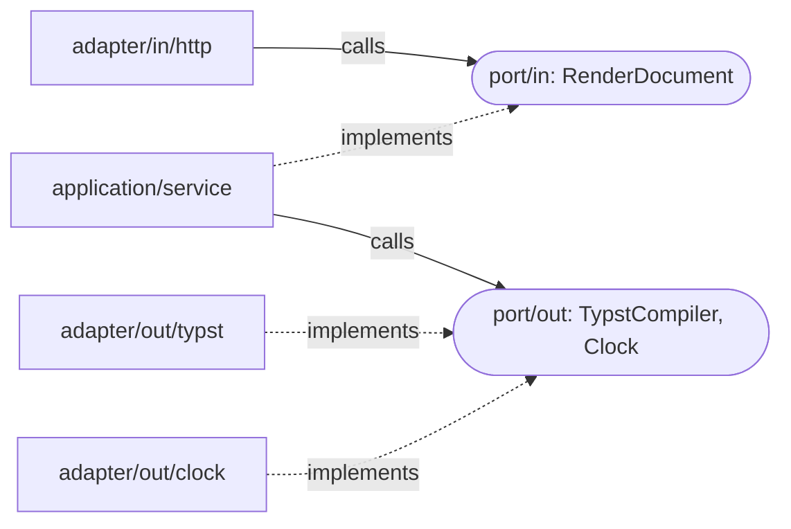

# docspawner

**Turn a Typst template and JSON data into a PDF with one HTTP call.**

docspawner is a stateless PDF rendering worker. Your service sends the template and the data. docspawner returns the PDF, or an error that says exactly what to fix. It stores nothing, so you can run as many copies as you need.

- **Fast:** about 20 ms for a 2-page invoice. No headless browser.
- **Predictable:** the same template, data, and timestamp give the same PDF bytes.
- **Safe for untrusted templates:** compile timeout, size limits, an isolated folder per render, no network access.
- **Clear errors:** compile errors come with line, column, and Typst's hints.
- **Built as a worker:** a fixed number of render slots, a bounded queue, `503` with `Retry-After` when full, and graceful shutdown.
- **Documented:** OpenAPI 3.1 and Swagger UI at `/docs`.

## Quick start

With Docker (Typst is included in the image):

```sh
docker compose up --build -d
curl -s localhost:3000/health
# {"status":"ok","typstVersion":"0.15.1","renders":{"active":0,"queued":0,"maxConcurrent":1,"maxQueued":100}}
```

Render a PDF:

```sh
curl -s localhost:3000/render \
  -H 'content-type: application/json' \
  -d '{"template": "#let data = json(\"data.json\")\n= Hello #data.name", "data": {"name": "Ana"}}' \
  -o hello.pdf
```

Or render one of the examples (needs `jq`):

```sh
examples/render.sh certificate-of-analysis
# Saved examples/certificate-of-analysis/certificate-of-analysis.pdf
```

Then open the API documentation at <http://localhost:3000/docs>.

## Template contract

The template reads its data from the file `data.json`. This is the only rule.

```typst
#let data = json("data.json")
= Invoice #data.number
Customer: #data.customer
```

| Available in a template                                                          | Not available                                           |
| -------------------------------------------------------------------------------- | ------------------------------------------------------- |
| All Typst markup and scripting                                                   | Images and other files (one template file only)         |
| Fonts embedded in Typst: Libertinus Serif, New Computer Modern, DejaVu Sans Mono | System fonts, unless added with `DOCSPAWNER_FONT_PATHS` |
| `datetime.today()`, set by `options.timestamp`                                   | `@preview` packages from the network                    |

## Examples

Each example is a folder with `template.typ` and `data.json`: exactly what you send to `POST /render`. A test renders every example with the real Typst binary.

| Example                                                         | What it shows                                                                                                                                                                                                                                                                                                   |
| --------------------------------------------------------------- | --------------------------------------------------------------------------------------------------------------------------------------------------------------------------------------------------------------------------------------------------------------------------------------------------------------- |
| [`certificate-of-analysis/`](examples/certificate-of-analysis/) | A pharmaceutical Certificate of Analysis: product and batch data, the chemical formula with subscripts, the **molecular structure** of paracetamol and a **dissolution-profile chart**, both drawn with built-in Typst shapes, a test-results table with pass/fail, and QA approvals                            |
| [`cold-chain-shipment/`](examples/cold-chain-shipment/)         | A cold-chain shipment report for vaccines and insulin: contents table, a **temperature chart** with the allowed 2–8 °C range, statistics computed in the template (minimum, maximum, average, **mean kinetic temperature**), and a release decision that switches to quarantine if any reading leaves the range |
| [`invoice/`](examples/invoice/)                                 | A 2-page invoice: a table whose header repeats on each page, computed totals, page numbers                                                                                                                                                                                                                      |

Run `examples/render.sh <example>` against a running worker. It saves the PDF in the example's folder, for example `examples/invoice/invoice.pdf`. If the request fails, it prints the error and writes no file. Set `DOCSPAWNER_URL` when the worker is not at `http://127.0.0.1:3000`. The examples use no Typst packages, because the worker blocks package downloads.

## API

### `POST /render`

```json
{
  "template": "#let data = json(\"data.json\")\n= Hello #data.name",
  "data": { "name": "Ana" },
  "options": { "timestamp": 1763251200, "timeoutMs": 5000 }
}
```

| Field               | Required | Description                                                       |
| ------------------- | -------- | ----------------------------------------------------------------- |
| `template`          | Yes      | Full Typst source, max 1 MB                                       |
| `data`              | Yes      | Any JSON value, max 5 MB. The template reads it as `data.json`.   |
| `options.timestamp` | No       | Document date as UNIX seconds. Send it for byte-identical output. |
| `options.timeoutMs` | No       | Compile time limit, from 1 to 60000. Default: 10000.              |

| Status | Meaning                    | Body                                                              |
| ------ | -------------------------- | ----------------------------------------------------------------- |
| `200`  | PDF rendered               | `application/pdf`, sent as `document.pdf`                         |
| `400`  | Invalid request            | `{ "error": { "kind": "invalid_input", "message" } }`             |
| `408`  | Compile took too long      | `{ "error": { "kind": "timeout", "timeoutMs" } }`                 |
| `413`  | Template or data too large | `{ "error": { "kind": "input_too_large", ... } }`                 |
| `422`  | Template does not compile  | `{ "error": { "kind": "compile_failed", "diagnostics": [...] } }` |

A misspelled field (`#data.nmae` instead of `#data.name`) returns `422`:

```json
{
  "error": {
    "kind": "compile_failed",
    "diagnostics": [
      {
        "severity": "error",
        "message": "dictionary does not contain key \"nmae\"",
        "file": "main.typ",
        "line": 2,
        "column": 15
      }
    ]
  }
}
```

Response headers on `200`: `x-typst-version`, `x-render-duration-ms`, `x-typst-warnings`.

### `GET /health`

Returns `{ "status": "ok", "typstVersion": "0.15.1" }`. The server checks Typst at startup and does not start without it.

### API documentation

| Where                                    | What                                                        |
| ---------------------------------------- | ----------------------------------------------------------- |
| `/docs`                                  | Swagger UI. Use "Try it out" and download the PDF.          |
| `/docs/json`                             | OpenAPI 3.1 document                                        |
| [`docs/openapi.json`](docs/openapi.json) | The same document as a file. `pnpm check` keeps it current. |

## Configuration

Environment variables. The server checks them at startup and lists every invalid one.

| Variable                            | Default        | Description                                                               |
| ----------------------------------- | -------------- | ------------------------------------------------------------------------- |
| `PORT`                              | `3000`         | HTTP port                                                                 |
| `HOST`                              | `127.0.0.1`    | Bind address. The Docker image uses `0.0.0.0`.                            |
| `LOG_LEVEL`                         | `info`         | `fatal`, `error`, `warn`, `info`, `debug`, `trace`, `silent`              |
| `TYPST_BIN`                         | `typst`        | Path to the Typst binary                                                  |
| `DOCSPAWNER_FONT_PATHS`             | none           | Extra font folders, separated by `:`                                      |
| `DOCSPAWNER_MAX_CONCURRENT_RENDERS` | number of CPUs | Renders that run at the same time. Match it to the CPUs of the container. |
| `DOCSPAWNER_MAX_QUEUED_RENDERS`     | `100`          | Renders that wait for a free slot. More requests get `503`.               |

## Guarantees and limits

**Deterministic output.** The same template, data, and `options.timestamp` give a byte-identical PDF. The Typst version is pinned, system fonts are ignored, and the timestamp sets the document date.

**Untrusted templates.** A template is a program, so docspawner contains it:

| Risk                    | Control                                                          |
| ----------------------- | ---------------------------------------------------------------- |
| Endless or slow compile | Timeout (default 10 s, max 60 s), then the process is killed     |
| Large input             | Template max 1 MB, data max 5 MB, HTTP body max 8 MB             |
| Read files on the host  | Typst only reads inside a fresh temp folder per render           |
| Network access          | Package downloads are blocked                                    |
| Resource use (Docker)   | Read-only file system, `tmpfs` for `/tmp`, memory and CPU limits |

**No authentication.** Run docspawner inside a trusted network or behind an API gateway.

**Capacity.** The worker runs `DOCSPAWNER_MAX_CONCURRENT_RENDERS` renders at once. Other requests wait in a first-in, first-out queue. The compile timeout starts when a render starts, so time in the queue does not count. When the queue is full, the worker returns `503` with `Retry-After` at once. `/health` reports the current load.

## Running in production

docspawner is a stateless worker: scale it by running more copies behind a load balancer.

| Topic       | What the image and `docker-compose.yml` do                                                      |
| ----------- | ----------------------------------------------------------------------------------------------- |
| Image       | `node:24-slim`, Typst 0.15.1 (SHA-256 checked at build), the built worker. No build tools.      |
| User        | Runs as `node`, not root. All Linux capabilities dropped, `no-new-privileges`.                  |
| File system | Read-only. Temp files go to a 256 MB `tmpfs` at `/tmp`.                                         |
| Resources   | 1 CPU, 512 MB, at most 128 processes. Set `DOCSPAWNER_MAX_CONCURRENT_RENDERS` to the CPU count. |
| Health      | Docker `HEALTHCHECK` on `/health` every 15 s. Use the same endpoint for load balancer checks.   |
| Shutdown    | On `SIGTERM`, stops accepting requests and finishes running and queued renders (up to 25 s).    |
| Signals     | `init: true` forwards signals and reaps child processes.                                        |
| Logs        | JSON lines on stdout (Fastify/pino), with request IDs.                                          |

To size a deployment: one render slot per CPU, and enough copies that the queue stays short at peak. `/health` shows `active` and `queued` for each copy.

## Performance

`pnpm bench` renders the example invoice (40 items, 2 pages) through the render service, without HTTP, on an Apple Silicon laptop with Typst 0.15.1:

| Runs            | p50          | p95          | PDF size |
| --------------- | ------------ | ------------ | -------- |
| 3 × 100 renders | 18.4–19.5 ms | 19.8–20.7 ms | 58.9 KiB |

Each render includes the start of a new Typst process.

### As a worker

Measured with `pnpm load` against the Docker image with `docker-compose.yml` settings: 1 CPU, 512 MB, 1 render slot.

| Test                                               | Result                                           |
| -------------------------------------------------- | ------------------------------------------------ |
| Example invoice, 200 requests, 1 at a time         | 63 PDF/s · p50 16 ms · p95 18 ms                 |
| Example invoice, 200 requests, 64 at a time        | 60 PDF/s · p50 1043 ms · p95 1131 ms · all `200` |
| Burst of 80 heavy renders (~200 ms each) at once   | 80 of 80 succeed in 14 s                         |
| Burst of 200 heavy renders, queue of 100           | 101 succeed, 99 get `503` with `Retry-After`     |
| `docker compose stop` with 1 running and 22 queued | All 30 requests finish with `200`, stop in 4 s   |
| Peak memory under load                             | under 100 MiB                                    |

Without the render queue, the same burst of 80 heavy renders failed 72 of 80 with `408`: every render shared one CPU and reached the timeout. See [ADR-0011](docs/adr/0011-bounded-render-queue.md).

## Architecture

docspawner uses **hexagonal architecture** (ports and adapters), with the standard layout from Tom Hombergs' _Get Your Hands Dirty on Clean Architecture_. The full explanation is in [ADR-0004](docs/adr/0004-ports-and-adapters.md).

One rule organizes the folders: **`in` means someone calls us. `out` means we call someone.**

```
src/
├── domain/                     The data the worker works with
│   └── render.ts                   request, result, errors, limits
├── application/                The core logic
│   ├── port/
│   │   ├── in/                     What we offer     → RenderDocument
│   │   └── out/                    What we need      → TypstCompiler, Clock
│   └── service/                    How we do it      → render service, input checks, render slots
├── adapter/                    The outside world
│   ├── in/http/                    Requests come in  → Fastify routes, schemas, Swagger
│   └── out/
│       ├── typst/                  We call Typst     → runs the binary, parses its errors
│       └── clock/                  We read the time  → system clock
├── config.ts                   Settings from environment variables
└── main.ts                     Builds everything and starts the worker

test/                           Same folders as src/, plus the architecture test
```



**The dependency rule:** every import points inward. `domain` and `application` never import an adapter, and only adapters do I/O. [`test/architecture.test.ts`](test/architecture.test.ts) checks every import in `src/`.

Expected failures are values, not exceptions. The HTTP adapter maps them to status codes.

Around the code:

| Folder              | Contents                                                                                        |
| ------------------- | ----------------------------------------------------------------------------------------------- |
| `examples/`         | Example templates and data, and `render.sh` to send one to a running worker                     |
| `docs/adr/`         | Architecture decision records                                                                   |
| `docs/openapi.json` | The API contract, generated from the route schemas                                              |
| `scripts/`          | `bench.ts` (render speed), `load.ts` (load test), `export-openapi.ts` (writes the API contract) |

## Decisions

Architecture decision records are in [`docs/adr/`](docs/adr/):

| ADR                                                        | Decision                                               |
| ---------------------------------------------------------- | ------------------------------------------------------ |
| [0001](docs/adr/0001-typst-instead-of-headless-browser.md) | Typst instead of a headless browser (Puppeteer)        |
| [0002](docs/adr/0002-stateless-renderer.md)                | Stateless renderer: the caller sends the full template |
| [0003](docs/adr/0003-data-contract-data-json.md)           | Data reaches the template as the file `data.json`      |
| [0004](docs/adr/0004-ports-and-adapters.md)                | Hexagonal architecture (ports and adapters)            |
| [0005](docs/adr/0005-typst-cli-process-per-render.md)      | Run the Typst CLI as a new process for each render     |
| [0006](docs/adr/0006-deterministic-output.md)              | Same input, same PDF bytes                             |
| [0007](docs/adr/0007-contain-untrusted-templates.md)       | Treat every template as untrusted code                 |
| [0008](docs/adr/0008-mcp-returns-paths-and-text-errors.md) | MCP tools return paths and text errors (deprecated)    |
| [0009](docs/adr/0009-no-cli-adapter.md)                    | No CLI adapter                                         |
| [0010](docs/adr/0010-http-api-only.md)                     | HTTP API only: the MCP adapter is removed              |
| [0011](docs/adr/0011-bounded-render-queue.md)              | A fixed number of render slots and a bounded queue     |

## Development

Requirements: Node 24 (see `.nvmrc`), pnpm, and Typst 0.15.1 on `PATH`.

```sh
pnpm install
pnpm start         # build and start the server on :3000
pnpm check         # everything CI runs
```

| Command                             | Purpose                                                                                 |
| ----------------------------------- | --------------------------------------------------------------------------------------- |
| `pnpm check`                        | Everything CI runs: format, lint, unused code, types, tests with coverage, OpenAPI file |
| `pnpm test` / `pnpm test:coverage`  | Unit, adapter, architecture, example, and end-to-end tests (real Typst)                 |
| `pnpm format` / `pnpm format:check` | Format with oxfmt / check the format                                                    |
| `pnpm lint`                         | Type-aware oxlint. Warnings fail, and lint-suppression comments fail.                   |
| `pnpm knip`                         | Find unused files, exports, and dependencies                                            |
| `pnpm typecheck`                    | Type check                                                                              |
| `pnpm openapi`                      | Regenerate `docs/openapi.json`                                                          |
| `pnpm bench` / `pnpm load`          | Measure render time / load-test a running worker                                        |

Code standards for contributors and AI agents are in [`CLAUDE.md`](CLAUDE.md).

CI ([`.github/workflows/ci.yml`](.github/workflows/ci.yml)) runs `pnpm check` and builds the Docker image.

## Scope

docspawner does one thing. Out of scope by design: template storage and versioning, authentication, an editor, async jobs, multi-file templates, and an MCP server.
