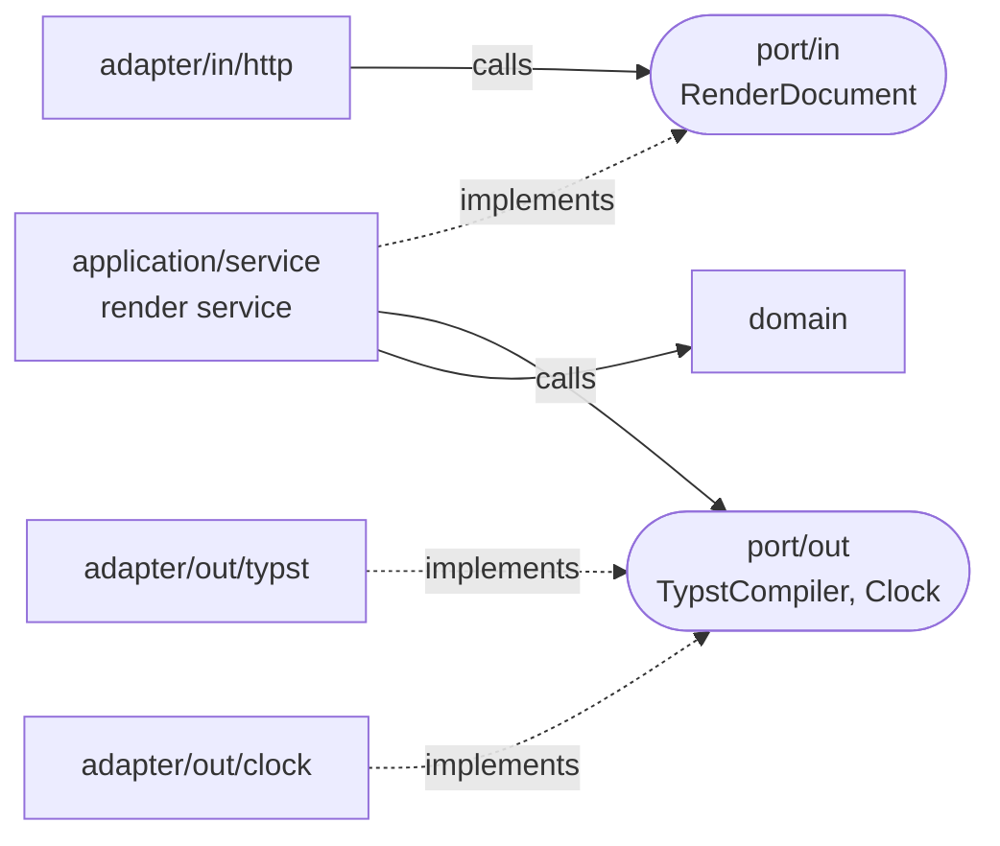

# Hexagonal architecture (ports and adapters)

Status: accepted

## Context

docspawner is an HTTP worker that wraps Typst. The logic is small, but it touches two technologies that can change:

- **Who calls it:** today an HTTP API. Before, also an MCP server for AI agents (removed in ADR-0010).
- **What does the work:** today the `typst` command-line binary. Later, maybe an embedded Typst library (ADR-0005).

The logic must also be testable without an HTTP server and without the Typst binary.

## Decision

We use **hexagonal architecture** (ports and adapters) with the standard folder layout from Tom Hombergs, _Get Your Hands Dirty on Clean Architecture_, and its sample project "BuckPal". It is a common layout, and other engineers recognize it.

The layout rests on one rule: **`in` means someone calls us. `out` means we call someone.**

```
src/
├── domain/                     The data the worker works with
│   └── render.ts                   request, result, errors, limits
├── application/                The core logic
│   ├── port/
│   │   ├── in/                     What we offer     → render-document.ts (RenderDocument)
│   │   └── out/                    What we need      → typst-compiler.ts, clock.ts
│   └── service/                    How we do it      → render-service.ts, validate-request.ts, render-slots.ts
├── adapter/                    The outside world
│   ├── in/http/                    Requests come in  → Fastify routes, schemas, Swagger
│   └── out/
│       ├── typst/                  We call Typst     → runs the binary, parses its errors
│       └── clock/                  We read the time  → system clock
├── config.ts                   Settings from environment variables
└── main.ts                     Composition root: builds everything and starts the worker
```



### The three kinds of code

| Kind         | Folders                       | Question it answers                    |
| ------------ | ----------------------------- | -------------------------------------- |
| **Core**     | `domain/`, `application/`     | What does the worker do?               |
| **Adapters** | `adapter/in/`, `adapter/out/` | How does it talk to the outside world? |
| **Startup**  | `main.ts`, `config.ts`        | How is it put together?                |

### The dependency rule

Every import points inward, toward the domain.

| Layer                 | May import                  | May use packages | May do I/O |
| --------------------- | --------------------------- | ---------------- | ---------- |
| `domain`              | `domain`                    | none             | No         |
| `application/port`    | `domain`, `port`            | none             | No         |
| `application/service` | `domain`, `port`, `service` | `zod` only       | No         |
| `adapter`             | `domain`, `port`, `adapter` | any              | Yes        |

`main.ts` and `config.ts` may import anything, because their job is to connect the parts. No layer may import them.

`test/architecture.test.ts` checks this rule on every import in `src/`. A wrong import fails the test with a message such as `service must not import adapter: ../../adapter/in/http/app.js`.

### Why this is hexagonal and not only layered

1. **The core owns its interfaces.** `TypstCompiler` describes what the service needs (`compile(job)` returns an outcome). It says nothing about processes, temp folders, or command output. The adapter translates.
2. **Callers and tools are both adapters.** HTTP (`in`) and Typst (`out`) are both outside the core. The core is not "on top of" Typst or "under" HTTP.
3. **The core runs without adapters.** Tests run the render service with a fake compiler and a fixed clock. No server and no Typst binary are needed.

### Errors are values

Expected failures (invalid input, compile error, timeout, busy) return `{ ok: false, error }`. They are not thrown. The HTTP adapter maps each one to a status code. Only real faults, such as a missing Typst binary, are thrown.

## Evidence: changes this design made cheap

| Change                                                              | What changed                                                 | What did not change      |
| ------------------------------------------------------------------- | ------------------------------------------------------------ | ------------------------ |
| Added, then removed, an MCP server for AI agents (ADR-0010)         | One adapter added, then deleted                              | Core                     |
| Added render slots for worker load (ADR-0011)                       | One service class, `RenderSlots`, used by the render service | Ports and adapters       |
| Unit tests for the render service                                   | Fakes for `TypstCompiler` and `Clock`                        | No HTTP, no Typst binary |
| Replace the Typst CLI with an embedded library (possible, ADR-0005) | One new adapter in `adapter/out/typst/`                      | Core and HTTP adapter    |

A review also caught one mistake. The first version of the render slots implemented the `TypstCompiler` port, so the port had to return `busy`. That leaked a queue concept into the port. The slots now live in `application/service/` and wrap the call to the port. `TypstCompiler` only compiles.

## Considered options

- **Layered (controller → service → Typst):** simpler, but HTTP is the center and the service depends on Typst directly. Tests need the binary.
- **Two packages (`core` and `http`):** we used this first. It added a workspace, build ordering, and a second composition root (a library API), but enforced little: driven adapters shared a package with the core. One package plus the architecture test is simpler and enforces more.
- **Full Clean Architecture** (entities, use cases, interface adapters, frameworks, a class per concept): too many layers for one use case.

## Consequences

- More files than one HTTP handler. Each file has one role, and its folder says which.
- Ports must stay small. A port that grows to fit one technology leaks that technology into the core.
- A new feature starts with one question: is it domain, a port, a service, or an adapter? The answer decides the folder.

## Terms

| Term             | Meaning here                                                                            |
| ---------------- | --------------------------------------------------------------------------------------- |
| Port             | An interface the core defines: `RenderDocument` (in), `TypstCompiler` and `Clock` (out) |
| Adapter          | Code that connects a port to a technology: HTTP, the Typst CLI, the system clock        |
| `in` (driving)   | Someone calls the core through it. Here: the HTTP adapter.                              |
| `out` (driven)   | The core calls the outside world through it. Here: Typst and the clock.                 |
| Service          | Code that implements an inbound port and uses outbound ports. Here: the render service. |
| Composition root | The one place that creates and connects everything. Here: `main.ts`.                    |
